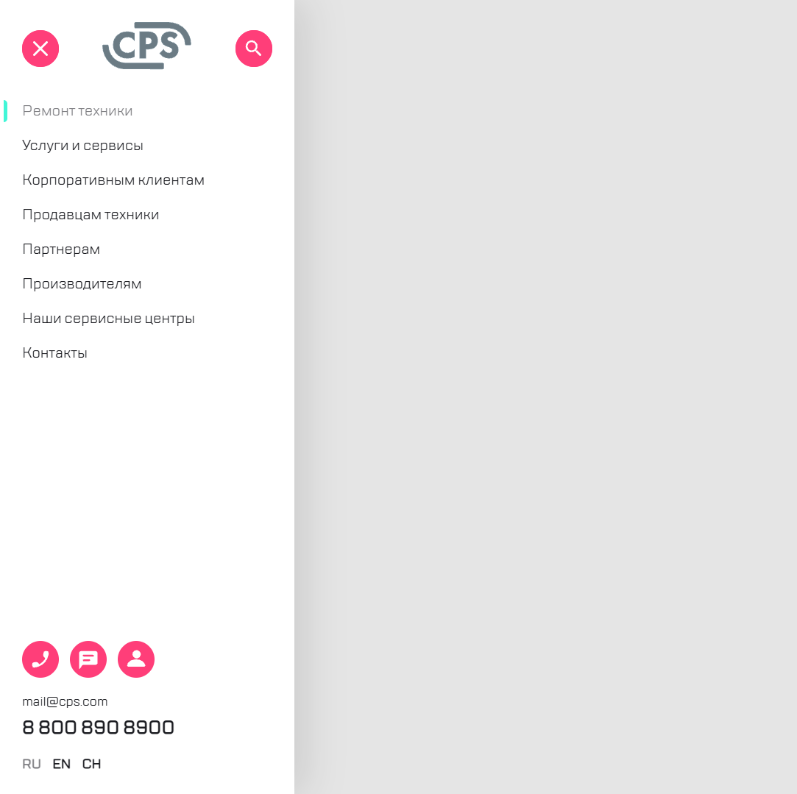

# Мобильное меню (CPS)

Проект адаптивного бокового меню для мобильных устройств, сверстанный по макету из Figma.

## Ссылки
* **Репозиторий:** [GitHub Repository](https://github.com/Russtam16/fourth_project_rustam_habsida_web_core_7.8.git)
* **Живая страница (GitHub Pages):** [Открыть сайт](https://russtam16.github.io/fourth_project_rustam_habsida_web_core_7.8/)

## Превью
